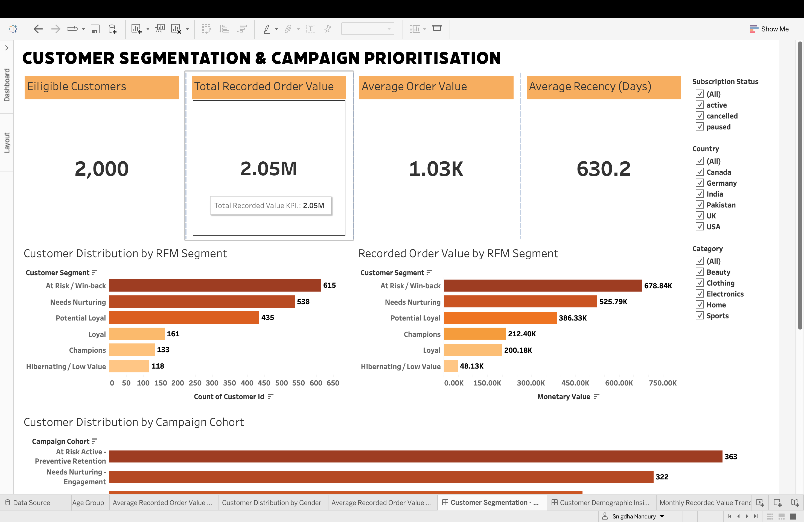
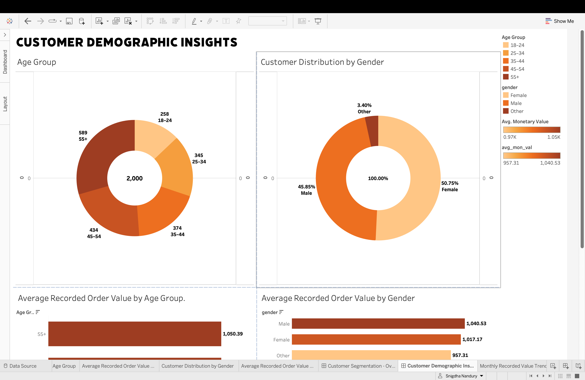
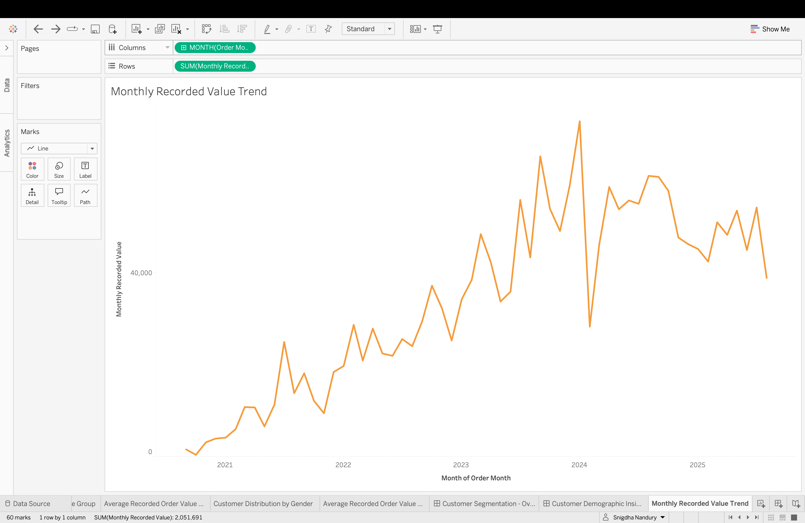
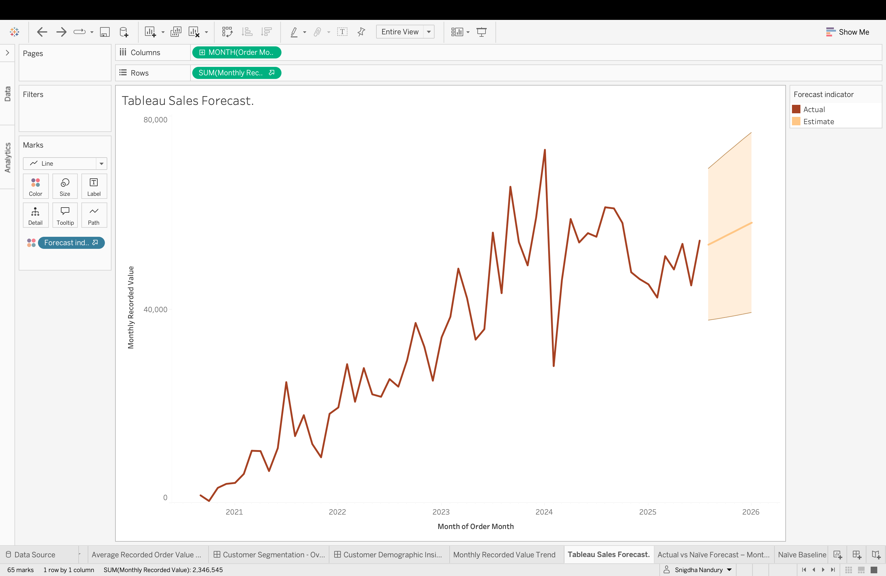
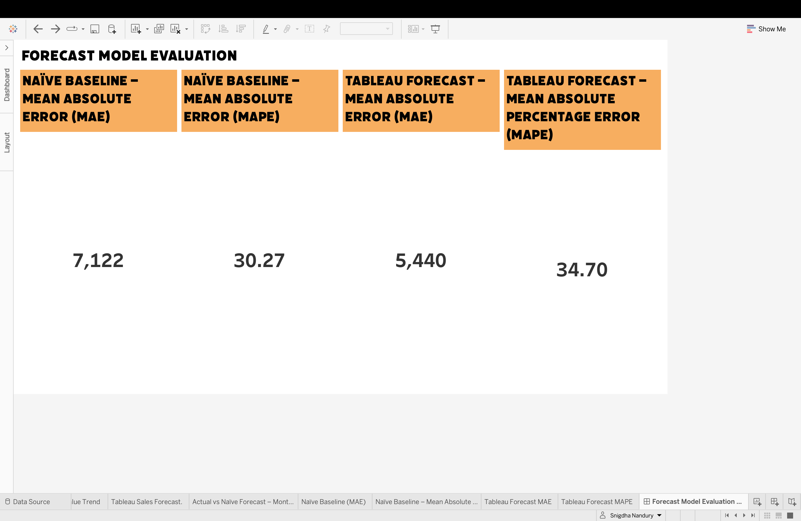

# E-commerce Customer Insights & Churn Analysis

An end-to-end customer and marketing analytics portfolio project using **MySQL, Tableau Public and GitHub**. The project covers data validation, RFM-style customer segmentation, campaign cohort prioritisation, demographic exploration and an exploratory monthly time-series forecast.

> **Important scope note:** The source contains one customer-associated record per customer, not a complete transaction history. `recorded_order_value = unit_price × quantity` is a single-record measure, not lifetime spend, profit or verified revenue. Currency is unspecified. Campaign costs, responses, incremental outcomes and control-group data are unavailable, so actual campaign ROI cannot be calculated.

## Business question

**Which customer groups should a marketing team prioritise for a retention or re-engagement pilot, and how can the team test that prioritisation?**

## Tools

- **MySQL:** validation, date parsing, RFM scoring, campaign cohorts and monthly aggregation.
- **Tableau Public:** segmentation, demographic, trend, forecast and forecast-evaluation dashboards.
- **GitHub:** SQL scripts, methodology, findings, limitations and reproducibility notes.

## Dataset and analysis scope

Source: [E-commerce Customer Insights and Churn Dataset — Kaggle](https://www.kaggle.com/datasets/nabihazahid/e-commerce-customer-insights-and-churn-dataset)

- Source population: **2,000 records and 2,000 distinct customer IDs**.
- Customer segmentation and demographic dashboards: **2,000 customers**.
- Monthly recorded-value series: **60 months**, September 2020–August 2025.
- RFM reference date and source snapshot cutoff: **20 August 2025**.
- Currency is not specified; monetary values are therefore shown without a currency symbol.

Date validation was revised after checking the source data dictionary and chronology. The associated `order_date` is the date an order was placed; a later `last_purchase_date` is not inherently contradictory. The final validation retains records where all three dates parse, signup is no later than the associated order date and last purchase date, and both order and last-purchase dates are no later than 20 August 2025. All 2,000 records passed these checks. See [methodology](documentation/methodology.md).

## Key customer-segmentation findings

| RFM segment | Customers | Share |
|---|---:|---:|
| At Risk / Win-back | 615 | 30.75% |
| Needs Nurturing | 538 | 26.90% |
| Potential Loyal | 435 | 21.75% |
| Loyal | 161 | 8.05% |
| Champions | 133 | 6.65% |
| Hibernating / Low Value | 118 | 5.90% |
| **Total** | **2,000** | **100.00%** |

The largest segment is At Risk / Win-back. This is a behavioural prioritisation hypothesis, not a prediction of response or future value.

## Campaign cohort distribution

| Campaign cohort | Customers |
|---|---:|
| At Risk Active - Preventive Retention | 363 |
| Needs Nurturing - Engagement | 322 |
| Potential Loyal - Growth | 280 |
| Needs Nurturing - Reactivation | 216 |
| At Risk Cancelled - Win-back | 160 |
| Potential Loyal - Reactivation | 155 |
| Loyal Active - Reward | 99 |
| At Risk Paused - Re-engagement | 92 |
| Hibernating - Low Cost Engagement | 71 |
| Champions - Protect | 69 |
| Champions - Reactivation | 64 |
| Loyal - Reactivation | 62 |
| Hibernating - Selective Reactivation | 47 |
| **Total** | **2,000** |

A practical next step is to pilot different messages and offers across behavioural cohorts, include a holdout group, and measure campaign cost, incremental retention/conversion and margin before reallocating budget. The cohort labels are proposed strategies, not measured outcomes.

## Demographic snapshot

The updated Tableau demographic dashboard covers 2,000 customers:
- Age counts: 18–24 **258**; 25–34 **345**; 35–44 **374**; 45–54 **434**; 55+ **589**.
- Gender distribution: Female **50.75%**; Male **45.85%**; Other **3.40%**.
- Average recorded order value by gender: Male **1,040.53**; Female **1,017.17**; Other **957.31**.

These are descriptive differences, not evidence that demographics cause purchasing behaviour or campaign response. The Other group is comparatively small.

## Monthly recorded-value forecasting

All 2,000 source records were aggregated into 60 calendar-month observations from September 2020 to August 2025.

- Total recorded order value: **2,051,690.65**.
- Tableau automatic forecast: six months, August 2025–January 2026, with a 95% prediction interval.
- Forecast model selected by Tableau: additive level and additive trend, no seasonal component.
- Evaluation dashboard KPIs: naïve baseline MAE **7,122** and MAPE **30.27%**; Tableau forecast MAE **5,440** and MAPE **34.70%**.

**Interpretation caution:** the MAE and MAPE cards are not a like-for-like model comparison because the underlying evaluation procedures differ. Tableau's lower displayed MAE does not establish overall superiority, especially with only one August 2025 holdout observation described in the forecast analysis. See [forecasting notes](analysis/sales-forecasting.md).

## Tableau Public dashboards

1. [Customer Segmentation & Campaign Prioritisation](https://public.tableau.com/app/profile/snigdha.nandury/viz/Book1_17947202352600/CustomerSegmentation-Overview#1)
2. [Customer Demographic Insights](https://public.tableau.com/app/profile/snigdha.nandury/viz/Book1_17947202352600/CustomerDemographicInsights_#1)
3. [Tableau Sales Forecast](https://public.tableau.com/app/profile/snigdha.nandury/viz/Book1_17947202352600/TableauSalesForecast_)
4. [Forecast Model Evaluation](https://public.tableau.com/app/profile/snigdha.nandury/viz/Book1_17947202352600/ForecastModelEvaluationDashboard)

## Dashboard previews

Select a preview to open its interactive Tableau Public dashboard. The screenshots are included here so the project can be reviewed directly from the repository.

<table>
  <tr>
    <td align="center">
      
       <strong>Customer Segmentation & Campaign Prioritisation</strong>
    </td>
    <td align="center">
      
       <strong>Customer Demographic Insights</strong>
    </td>
  </tr>
  <tr>
    <td align="center">
      
       <strong>Monthly Recorded Value Trend</strong>
    </td>
    <td align="center">
      
       <strong>Tableau Sales Forecast</strong>
    </td>
  </tr>
  <tr>
    <td align="center">
      
       <strong>Forecast Model Evaluation</strong>
    </td>
    <td></td>
  </tr>
</table>

## Repository guide

| Folder | Contents |
|---|---|
| `sql/` | MySQL preparation, RFM, campaign cohort, Tableau-ready and monthly forecast scripts |
| `analysis/` | Segmentation, demographic and forecasting findings |
| `documentation/` | Methodology, data dictionary and limitations |
| `dashboards/` | Published Tableau Public dashboard links and screenshot previews |

## Reproducibility

1. Download the source dataset from Kaggle.
2. Import it into MySQL as `ecommerce_customer_insights`.
3. Run the SQL scripts in numerical order.
4. Connect Tableau to the resulting views or exported CSVs.
5. Review the methodology and limitations before interpreting results.

The SQL scripts are intended as reproducible project documentation; validate them against your local MySQL schema and source-file column names before running.

---
Portfolio project. Findings are descriptive; campaign recommendations are hypotheses for testing.
