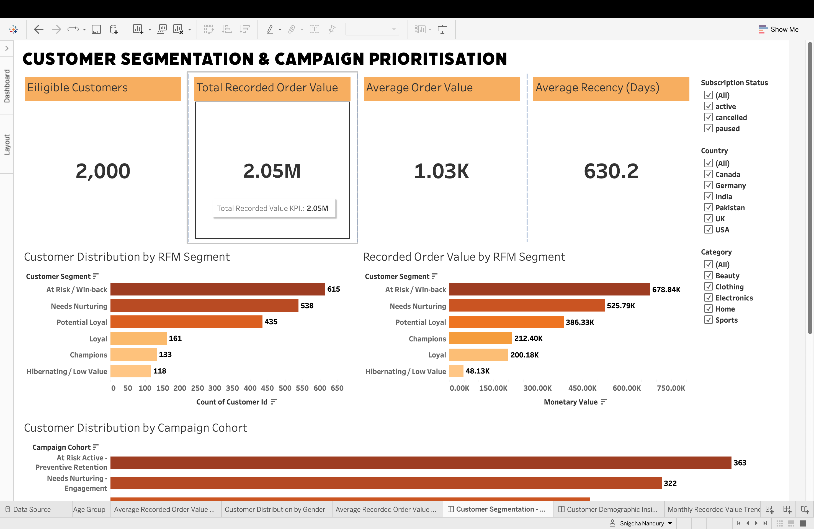
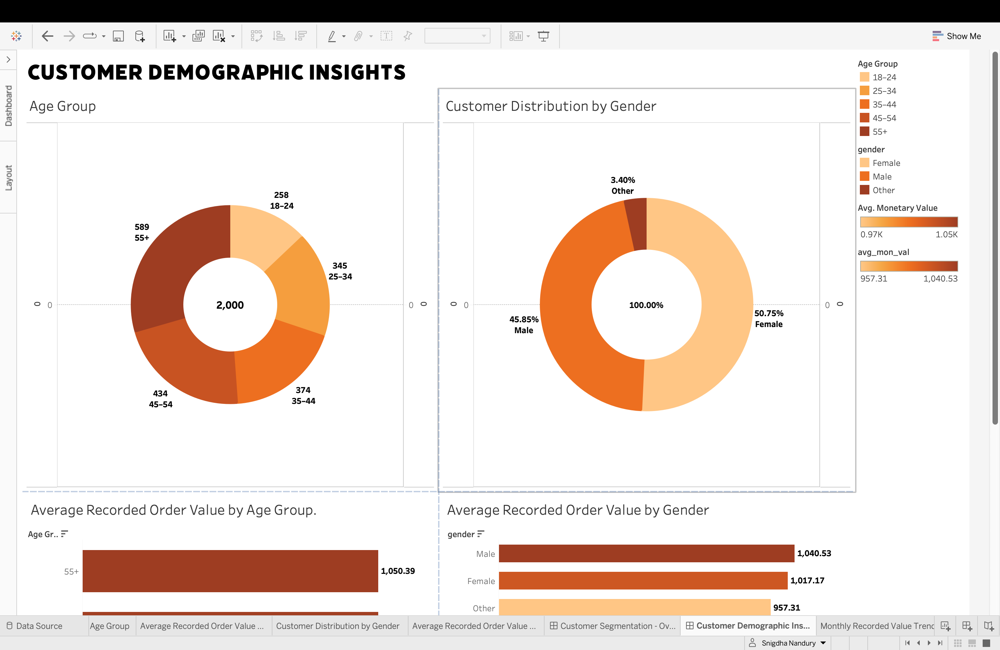
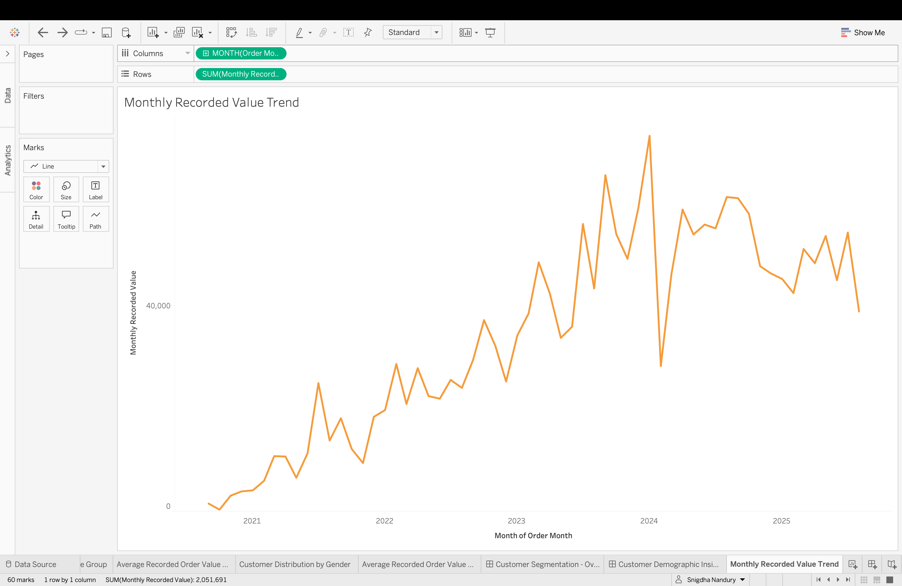
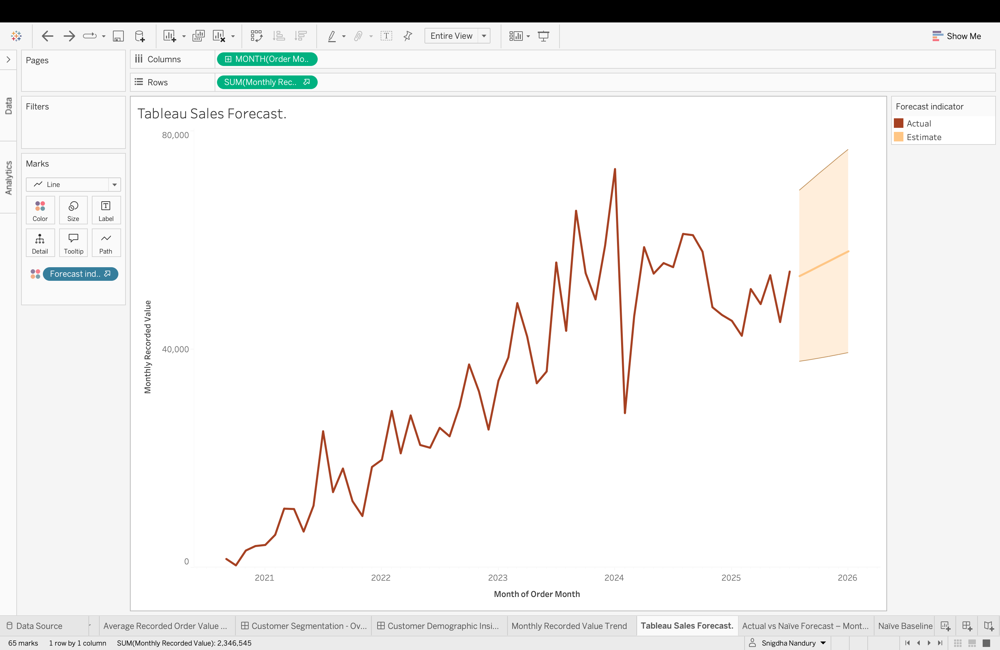
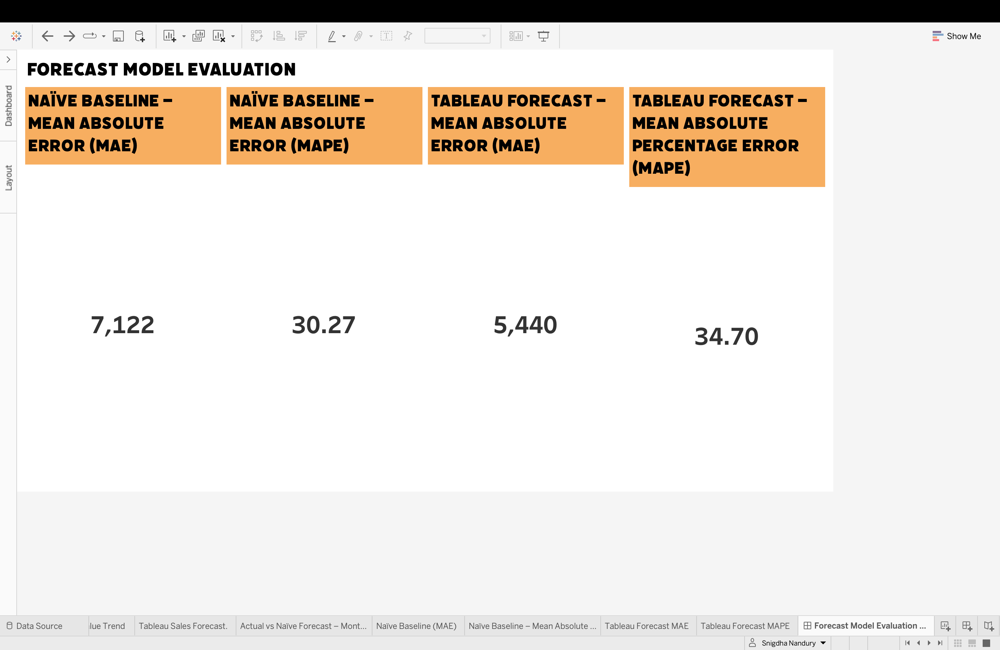

# Tableau Public Dashboards

Published Tableau Public dashboards for the E-commerce Customer Insights & Churn Analysis portfolio project.

1. [Customer Segmentation & Campaign Prioritisation](https://public.tableau.com/app/profile/snigdha.nandury/viz/Book1_17947202352600/CustomerSegmentation-Overview#1)
2. [Customer Demographic Insights](https://public.tableau.com/app/profile/snigdha.nandury/viz/Book1_17947202352600/CustomerDemographicInsights_#1)
3. [Tableau Sales Forecast](https://public.tableau.com/app/profile/snigdha.nandury/viz/Book1_17947202352600/TableauSalesForecast_)
4. [Forecast Model Evaluation](https://public.tableau.com/app/profile/snigdha.nandury/viz/Book1_17947202352600/ForecastModelEvaluationDashboard)

The customer dashboards reflect the updated 2,000-customer population. Forecasting uses the 2,000 source records aggregated into 60 monthly observations.

The forecast evaluation KPIs are not a like-for-like comparison: the naïve rolling metrics and Tableau forecast quality metrics use different evaluation procedures/periods. See `analysis/sales-forecasting.md`.

## Dashboard screenshot previews

The following images are presentation previews of the Tableau work. Select a published dashboard link above to explore the interactive version.

### Customer Segmentation & Campaign Prioritisation

### Customer Demographic Insights

### Monthly Recorded Value Trend

### Tableau Sales Forecast

### Forecast Model Evaluation

